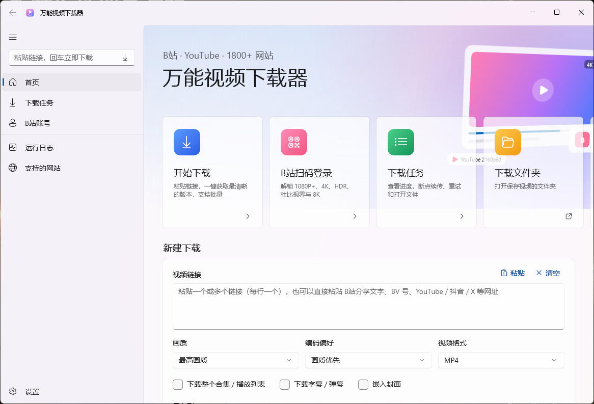
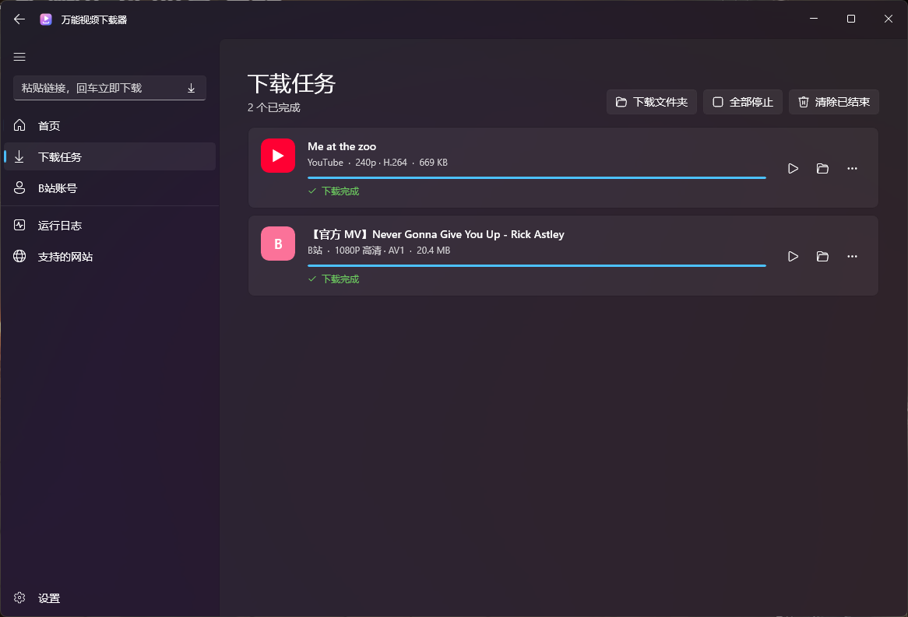
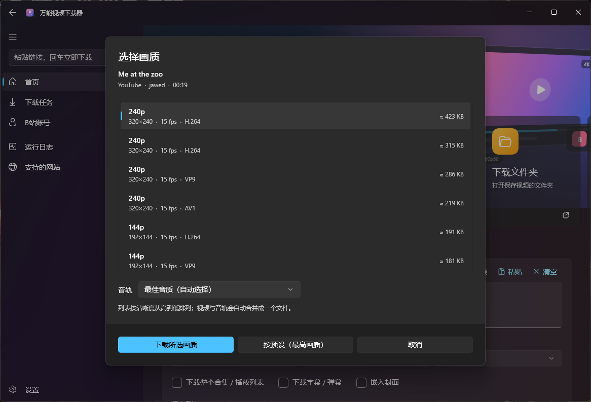
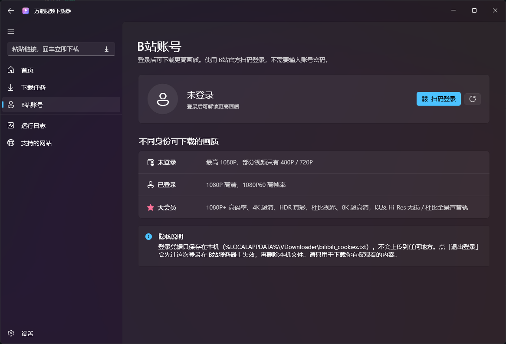

<div align="center">


# 万能视频下载器 · VDownloader

**原生 WinUI 3 界面的视频下载器：B站最高 8K、YouTube 最高 8K / HDR，另外还支持 1800 多个网站**

[](https://github.com/biubiu223/VDownloader/releases/latest)
[](https://github.com/biubiu223/VDownloader/releases)
[](LICENSE)


[下载](https://github.com/biubiu223/VDownloader/releases/latest) · [使用说明](#使用说明) · [常见问题](#常见问题) · [从源码构建](#从源码构建) · [English](#english)



</div>

## 功能特性

- 🎨 **原生 WinUI 3 界面**：Mica 背景、左侧导航，和 Windows 11 / WinUI 3 Gallery 同一种风格；支持浅色和深色主题。
- 📺 **B站高画质**：官方扫码登录（不需要输入密码），可解锁 1080P+、4K、HDR、杜比视界、8K，以及 Hi-Res 无损 / 杜比全景声音轨（这些需要大会员）。
- ▶️ **YouTube 及 1800+ 网站**：基于 [yt-dlp](https://github.com/yt-dlp/yt-dlp)，自动选择最高分辨率和码率。
- 🔍 **解析并选择画质**：列出全部清晰度、编码、HDR 信息和预估大小，可以单独指定音轨。
- 📋 **智能识别链接**：B站分享文案、BV 号、多行链接都能识别；复制链接后切回窗口，会自动提示下载。
- ⚡ **下载队列**：并发数可调；支持断点续传、重试；实时显示进度、速度和剩余时间；下载完成后弹出系统通知。
- 🎞️ **格式灵活**：画质预设（最高 / 4K / 2K / 1080p / 720p / 480p / 仅音频）、编码偏好（画质优先 / 兼容优先 H.264）、MP4 / MKV、合集 / 播放列表、字幕 / 弹幕、嵌入封面。
- 🌐 **网络友好**：默认跟随系统代理，国内网站自动直连；YouTube 等网站可以导入 Cookie。
- 📦 **开箱即用**：.NET、WinUI 运行库、yt-dlp、FFmpeg、Deno 全部内置，不需要另外安装任何东西。

## 截图

| 下载任务 | 选择画质 | B站账号 |
|---|---|---|
|  |  |  |

## 下载安装

到 [Releases](https://github.com/biubiu223/VDownloader/releases/latest) 下载：

| 文件 | 说明 |
|---|---|
| `VDownloader-x.y.z-Setup-x64.exe` | **安装版（推荐）**。默认只为当前用户安装，不需要管理员权限。可在“设置 → 应用”里卸载 |
| `VDownloader-x.y.z-win-x64-portable.zip` | **绿色版**。解压后双击 `VDownloader.exe` 就能用 |

- 系统要求：Windows 10 1809 及以上 / Windows 11，64 位。
- 安装包没有代码签名，首次运行时 SmartScreen 可能会拦截，点“更多信息 → 仍要运行”即可。
- 可以用 `SHA256SUMS.txt` 校验下载的文件是否完整。

## 使用说明

1. 在首页输入框里粘贴链接（一次可以贴好几个）。B站分享文字和 BV 号也能直接识别。
2. 选画质、编码偏好和格式，然后点 **开始下载**；想先看看有哪些清晰度，就点 **解析并选择画质**。
3. 左上角的小输入框更快：粘贴链接后按回车，按默认设置直接开始下载。
4. 下载默认保存到 `下载\视频下载`，可以在设置里修改。

| 选项 | 说明 |
|---|---|
| 画质优先 | 选最清晰的版本，可能是 AV1、VP9、HEVC 或 HDR |
| 兼容优先 | 分辨率一样时优先 H.264 + AAC + SDR，老电视和剪辑软件都能直接打开 |
| MP4 / MKV | MP4 兼容性最好；MKV 能保留无损音轨等全部内容 |

### B站高画质

打开左侧的 **B站账号**，点 **扫码登录**，再用哔哩哔哩 App 扫码。

| 身份 | 可下载画质 |
|---|---|
| 未登录 | 最高 1080P（部分视频只有 480P / 720P） |
| 已登录 | 1080P、1080P60 |
| 大会员 | 1080P+、4K、HDR、杜比视界、8K、Hi-Res 无损 / 杜比全景声 |

- 登录凭据用 **Windows 数据保护（DPAPI）加密**后，只保存在本机 `%LOCALAPPDATA%\VDownloader\bilibili_cookies.dat`。文件被拷到其他电脑或其他 Windows 账户上都无法解密。
- 下载 B站视频时，程序会临时解密出一份副本给 yt-dlp 使用，下载结束后立即覆盖删除。
- 从 1.0.0 升级时，旧的明文文件 `bilibili_cookies.txt` 会被自动转成加密文件，明文会被抹掉。
- 点 **退出登录** 会先让这次登录在 B站服务器上失效，再删除本机文件。
- 卸载时也可以选择一并删除。

### YouTube 等海外网站

- 程序默认使用 **系统代理**，Clash、v2rayN 等开启“系统代理”就行。也可以在 **设置 → 网络** 里自定义代理。
- 如果提示“确认你不是机器人”，请到 **设置 → 其他网站 Cookie** 选择从 Firefox 读取，或者导入 cookies.txt。

## 常见问题

<details>
<summary><b>下载失败，提示 403、格式不可用或解析错误？</b></summary>

网站经常改版。打开 **设置 → 组件 → yt-dlp → 检查更新**，把内核更新到最新版，通常就能解决。

</details>

<details>
<summary><b>为什么 B站只能下载 480P / 1080P？</b></summary>

要先扫码登录。4K、HDR、杜比视界、8K 还需要大会员账号。

</details>

<details>
<summary><b>下载的视频在电脑上放不了？</b></summary>

“画质优先”可能会选到 AV1 或 HEVC 编码。可以把编码偏好改成 **兼容优先 (H.264/SDR)**，或者换一个支持这些编码的播放器，比如 PotPlayer、mpv。

</details>

<details>
<summary><b>设置、日志保存在哪？</b></summary>

保存在 `%LOCALAPPDATA%\VDownloader`。打开 **设置 → 数据目录** 可以直接进入。

</details>

## 从源码构建

需要：Windows 10/11 x64、[.NET 8 SDK](https://dotnet.microsoft.com/download/dotnet/8.0)，制作安装包还需要 [Inno Setup 6.5+](https://jrsoftware.org/isdl.php)。

```powershell
git clone https://github.com/biubiu223/VDownloader.git
cd VDownloader

# 1. 下载 yt-dlp / FFmpeg / Deno 到 tools\（会自动校验 SHA-256）
.\scripts\fetch-tools.ps1

# 2. 一键构建：免安装目录 + 绿色版 zip + 安装包 + SHA256SUMS，输出到 dist\
.\scripts\build-release.ps1
```

日常开发直接用 `dotnet build VDownloader -p:Platform=x64` 编译调试即可。

### 发布新版本

1. 修改 `VDownloader/VDownloader.csproj` 里的 `<Version>`，并在 `CHANGELOG.md` 里写好这个版本的更新内容。
2. 提交代码后打标签并推送：`git tag v1.0.2`，然后 `git push origin v1.0.2`。
3. GitHub Actions 会自动构建并**直接发布 Release**，说明文字取自 `CHANGELOG.md` 里对应版本的段落。已安装旧版的用户启动软件时会收到新版本提示。

### 项目结构

```
├─ VDownloader/              WinUI 3 源码（C# / XAML）
│  ├─ Views/                 首页、下载任务、B站账号、运行日志、设置、画质选择对话框
│  ├─ Services/              下载队列、yt-dlp 调用、B站扫码登录、组件管理、设置、检查更新
│  ├─ Models/                任务模型、解析结果
│  └─ Controls/              设置卡片控件
├─ installer/                Inno Setup 安装脚本 + 简体中文语言文件
├─ scripts/                  fetch-tools.ps1（下载组件）、build-release.ps1（一键构建）
├─ tools/                    外部组件存放目录（exe 不提交到 git）
├─ docs/images/              README 截图
└─ .github/workflows/        自动构建与发布
```

## 致谢

- [yt-dlp](https://github.com/yt-dlp/yt-dlp)：强大的视频下载内核
- [FFmpeg](https://ffmpeg.org)、[Deno](https://deno.com)、[Windows App SDK](https://github.com/microsoft/WindowsAppSDK)、[QRCoder](https://github.com/codebude/QRCoder)、[Inno Setup](https://jrsoftware.org/isinfo.php)

完整的第三方许可证见 [THIRD-PARTY-NOTICES.md](THIRD-PARTY-NOTICES.md)。

## 许可证与免责声明

本项目以 [GPL-3.0](LICENSE) 许可证开源。

本软件仅供个人学习、研究与备份使用。请遵守当地法律和各网站的服务条款，尊重内容创作者的版权，不要下载或传播未经授权的内容。因使用本软件产生的任何后果由使用者自行承担。本项目与哔哩哔哩、YouTube 等网站没有任何关联。

---

## English

**VDownloader** is a native **WinUI 3** video downloader for Windows 10/11 (x64), powered by [yt-dlp](https://github.com/yt-dlp/yt-dlp).

- Download from Bilibili (up to 8K / Dolby Vision with QR-code login and a premium account), YouTube (up to 8K / HDR), and 1800+ other sites.
- Pick an exact quality, codec and audio track; supports playlists, subtitles, embedded thumbnails, and a download queue with resume.
- Everything is bundled (.NET, Windows App SDK, yt-dlp, FFmpeg, Deno), so there is nothing else to install.
- Grab the installer or the portable zip from [Releases](https://github.com/biubiu223/VDownloader/releases/latest).

Licensed under [GPL-3.0](LICENSE). For personal use only; please respect copyright and each site's terms of service.
